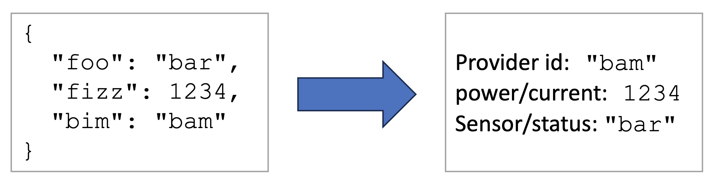

# Device factory core

The device factory handles raw update notifications from transport handlers.
The payload is parsed and its content is mapped to the Eclipse sensiNact model according to a configuration.

{.block-center}

The device factory core is not intended to be used directly, but through a transport-specific device factory.

## Bundles

The device factory bundle is: `org.eclipse.sensinact.gateway.southbound.device-factory:device-factory-core:0.0.2`.

The device factory core itself only requires the sensiNact core bundles (API and GeoJSON).
However, the parsers must be provided by their own implementation bundle.

## Parsers

Eclipse sensiNact includes the following parsers:
* [CSV](./csv.md)
* [JSON](./json.md)

A parser can be created following the [Device Factory Parser Tutorial](./tuto-parser.md).

## Device Factory Configuration

The configuration of the device factory is split into 4 parts:
* `parser`: the ID of the device factory parser to use to parse the payload.
* `parser.options`: parser-specific options to parse the payload. Refer to the parser documentation for more details.
* `mapping`: the resource mapping configuration, to associate a sensiNact resource to a value from the parser.
* `mapping.options`: options for the resource mapper, *e.g.* the date format in use, ...

Here is an example of a device factory configuration:
```json
{
  "parser": "csv",
  "parser.options": {
      "header": true
  },
  "mapping": {
      "@provider": "Name",
      "@latitude": "Latitude",
      "@longitude": "Longitude",
      "@date": "Date",
      "@time": "Time",
      "data/value": "Value"
  },
  "mapping.options": {
    "format.date": "d.M.y",
    "format.time": "H:m"
  }
}
```

## Mapping configuration

The mapping configuration links a sensiNact resource to a parser entry, to a literal or to a variable.

*Note that depending on the parser implementation, the available entries might not match exactly the payload content.*

### Mapping key

The key of the mapping entry can be in the following formats:
* `@xxx`: a placeholder used by the device factory to describe the update and to find the provider to update. Here are the placeholders sensiNact defines:
  * Provider description
    * `@model`: the name of the model of the provider to update
    * `@provider`: the name of the provider to update. **This placeholder is mandatory**.
    * `@name`: the friendly name of the provider (`admin/friendlyName`)
  * Location
    * `@location`: the location of the provider (`admin/location`). The content is expected to be either a GeoJSON object or a short location string (`latitude:longitude[:altitude]`). This placeholder overrides `@latitude`, `@longitude` and `@altitude` if they are defined.
    * `@latitude`: the latitude of the provider, to construct its location. This placeholder **must** be combined with `@longitude`.
    * `@longitude`: the longitude of the provider, to construct its location. This placeholder **must** be combined with `@latitude`.
    * `@altitude`: the altitude of the provider, to construct its location. This placeholder **must** be combined with `@latitude` and `@longitude`.
  * Update timestamp
    * `@timestamp`: the timestamp of the update either in second, millisecond or nanosecond precision (auto-detected). Overrides `datetime`, `@date` and `@time` if they are defined.
    * `@datetime`: the date and time of the update. Overrides `@date` and `@time` if they are defined. The datetime format can be defined in the mapping options.
    * `@date`: the date of the update, should be used with `@time`. The date format can be defined in the mapping options.
    * `@time`: the time of the update, should be used with `@date`. The time format can be defined in the mapping options.
* `$xxx`: definition of a variable that can be reused in or as a mapping value. The variable can be used in other mapping key or in record paths using the `${xxx}` syntax.
* `"svc/rc"`: the parser value will be stored in a the resource `rc` of the service `svc`

### Mapping value

The value of a mapping can be defined in many different formats.

In the examples of this section, we consider the input payload being a CSV file with the following content:

```csv
sensor,serial,nbVehicles,nbPersons
A1,ABC12,6,2
B1,ABC13,0,10
```

#### Record path

A mapping defined by a record path will get the value from the parser "as is".
This means the resource value will contain it in its parsed type.
For example, all the values from the CSV parser are strings, whereas the JSON parser will detect strings, numbers, booleans, arrays, ...

Here is an example of mapping the provider name to the record path `sensor` and the value of the resource `serial` in the service `sensor` from the record path `serial`:
```json
{
    "@provider": "sensor",
    "sensor/serial": "serial"
}
```

With the example payload, the mapping above defines two providers, `A1` and `B1`, each with a service `sensor` providing a resource `serial` with values being respectively `ABC12` and `ABC13`.

Both mapping keys and record paths can be constructed from variables.
For example, considering the following payload:
```csv
sensor,type,temperature,humidity
A,temperature,21,-1
B,humidity,-1,64
```

And the following mapping:
```json
{
    "$id": "sensor",
    "$kind": "type",
    "@provider": "${id}",
    "sensor/${kind}": "value"
}
```

We would obtain two providers:
* Provider `A` with a resource `temperature` in service `sensor`, with the value 21
* Provider `B` with a resource `humidity` in service `sensor`, with the value 64

Finally, note that the record path depends on the parser.
In the case of CSV payloads without headers, it is a column index number given as an integer (or the string representation of an integer). For example `"sensor/serial": 2`. Note that the first column index number is 0.
In the case of the JSON parser, it can be a path through objects or indices through arrays: `"sensor/serial": "sensor/array/0/serial`

For example, the path `sensor/array/0/serial` would allow to access the value `ABC123` in the following JSON payload:
```json
{
    "sensor": {
        "properties": {
            "kind": "multi-sensor"
        },
        "array": [
            {
                "serial": "ABC123",
                "type": "temperature",
                "year": 2021
            },
            {
                "serial": "ABC124",
                "type": "humidity",
                "year": 2022
            }
        ]
    }
}
```


#### Configured record path

##### Value type

Some parsers, like the CSV one, can't determine the type of the value they are parsing.
The mapping configuration allows to indicate the type the parsed value must be converted to.

For example, if we consider the payload:
```csv
sensor,serial,nbVehicles,nbPersons
ABC,12345,6,2
```

And the following mapping:
```json
{
    "@provider": "sensor",
    "sensor/serial": "serial",
    "sensor/vehicles": {
        "path": "nbVehicles",
        "type": "int"
    },
    "sensor/pedestrians": {
        "path": "nbPersons",
        "type": "float"
    }
}
```

We would a provider `ABC` with the following mapped resources in the `sensor` service:
* `serial`: `"12345"` as a string, as the CSV parser returns values as string by default
* `vehicles`: `6` as an integer
* `pedestrians`: 2.0 as float

The available types are:
* `any`: use the value as it was parsed (default)
* `string`: convert the value to a string
* `char`: convert the value to a Java character (2 bytes unsigned integer)
* `byte`: convert the value to a Java byte (1 byte signed integer)
* `short`: convert the value to a Java short integer (2 bytes signed)
* `int`, `long`: convert the value to an integer
* `float`, `double`: convert the value to floating point number
* `boolean`: convert the value to a boolean, truth being any number other than 0 or a string equal to `true` (case ignored)
* `any[]`: convert the value to a list of objects
* `string[]`: convert the value to a list of strings
* `char[]`: convert the value to a list of Java characters
* `byte[]`: convert the value to a list of bytes
* `short[]`: convert the value to a list of short integers
* `int[]`, `long[]`: convert to a list of integers
* `float[]`, `double[]`: convert to a list of floating point numbers
* `boolean[]`: convert to a list of booleans

:::{note}
If it is expected that the parsed field can have null value, it is recommended to explicit its type to correctly set up the right model inside Eclipse sensiNact.

For example:
```json
{
    "sensor/pedestrians": {
        "path": "nbPersons",
        "type": "float"
    }
}
```

It is also possible to set a default value:
```json
{
    "sensor/pedestrians": {
        "path": "nbPersons",
        "type": "float",
        "default": 0.0
    }
}
```
:::


**Note 2:**

##### Default value

The record path configuration can define a default value.
The default value will be treated as if it was read by the parser and will therefore be converted to the value type, if defined.
A default value that can't be converted to the value type is refused when the configuration is loaded.

The default value is used when the field is missing from the record: an entry with a `default` key behaves as if it had the `optional` and `default` [policies](#missing-and-invalid-values).
An explicit `null` value in the record is a value: it is kept as `null` and doesn't take the default value of a resource or metadata entry.
Place holders (`@provider`, `@name`...) and variables still take their default value when their field is missing or `null`.

```json
{
    "vehicle/count": {
        "path": "nbVehicles",
        "type": "int",
        "default": 0
    }
}
```

#### Literal value

It is also possible to construct literal values from the record paths and variables.

Here is an example to fix the `city` resource to `Grenoble`:
```json
{
    "sensor/city": {
      "literal": "Grenoble"
    }
}
```

Literals also support interpolation using the `${var}` format.


Here is an example of a complex use of variables, considering the following payload:
```csv
name,city
Thomas,Grenoble
```

And the following configuration:
```json
{
    "$name": {
        "path": "name",
        "default": "World",
        "type": "string"
    },
    "$words": {
        "literal": "HelloBye!"
    },
    "@name": "${name}",
    "greet/hello": "${words[:5]} ${name}!",
    "greet/bye": "${words[5:-1]} ${name}!"
}
```

We will have the provider friendly name set to "Thomas" and the "greet" service will have two resources:
* "hello": "Hello Thomas!"
* "bye": "Bye Thomas!"

### Missing and invalid values

A resource or metadata entry can't always be read from a record:
* its field can be missing from the record;
* its value can't be converted to the value type of the entry, for example `"n/a"` for an `int`.

By default, both cases reject the whole record: none of its values is applied, the other records of the payload are still handled, and the error is logged (see [error handling](#error-handling-options)).
An explicit `null` value is not an error: the resource is set to `null`, according to the `null.action` option.

This behaviour is set by policies, given as an array in the `policies` key of the mapping options, for all entries, or of an entry.
The policies go by pairs of opposites:

| Pair | Policies | Default | Case |
|------|----------|---------|------|
| Presence | `required` / `optional` | `required` | The field is missing from the record |
| Conversion | `strict` / `lenient` | `strict` | The value can't be converted to the value type |
| Fallback | `ignore` / `default` | `ignore` | What a tolerated value becomes: the resource keeps its previous value (`ignore`), or takes the default value of the entry, `null` if not set (`default`) |

The policies of an entry are merged pair by pair with the global ones: a pair set on the entry replaces the global one, the other pairs keep the global value.
An array holding both members of a pair, an unknown policy, or policies on a place holder, a variable or a literal are refused when the configuration is loaded.
Resources and metadata named after a variable, such as `${svcName}/data`, accept policies.
The fallback pair applies to both missing and invalid values of an entry: an entry can't take its default value for a missing field and ignore an invalid one.

For example, with the following mapping:
```json
{
    "parser": "json",
    "mapping": {
        "@provider": "station",
        "weather/temperature": {"path": "temperature", "type": "double"},
        "weather/humidity": {"path": "humidity", "type": "int", "policies": ["optional"]},
        "weather/pressure": {"path": "pressure", "type": "int", "default": 1013}
    },
    "mapping.options": {"policies": ["lenient"]}
}
```

* a record without `temperature` is rejected (required by default);
* a record with `"temperature": "n/a"` is applied without the temperature, which keeps its previous value (lenient, ignore);
* a record without `humidity` is applied without the humidity (optional, ignore);
* a record without `pressure` sets the pressure to 1013 (its `default` key implies `optional` and `default`);
* a record with `"humidity": null` sets the humidity to `null`.

### Variables

Variables are defined using the `$` prefix and no brackets (`{`, `}`).
They can be given a literal value or a value from the record.

Here are some example of variable definitions:
```json
{
    "$rc_value": "data", // ${rc_value} = <value in the "data" path>
    "$rc_value.2": {
        "path": "data"
        // ${rc_value.2} = <value in the "data" path>
    },
    "$svcName": {
        "literal": "service"
        // "${svcName}" = "service"
    },
    "$rcName": {
        "literal": "rc"
        // "${rcName}" = "rc"
    },
    "$rcValuePath": {
        "literal": "data"
        // "${rcValuePath}" = "data"
    }
    // ...
}
```

The variables can then be used both in the record paths or in the mapping definition.
Note that unlike other mappings, which are considered as path by default, variables are considered as literals.

For example:
```json
{
    // ...
    "${svcName}/${rcName}-txt": "${rcValuePath}", // service/rc-txt = "data"
    "${svcName}/${rcName}-value":{
        "path": "${rcValuePath}"
        // service/rc-value = <value in the "data" path>
    }
}
```

## Mapping options

The device factory mapper itself can be fine-tuned with the `mapping.options` entry.
Most of the options are relating to parsing patterns and input locales.

### Date time parsing options

Date inputs are given to a Java [`java.time.format.DateTimeFormatter`](https://docs.oracle.com/en/java/javase/11/docs/api/java.base/java/time/format/DateTimeFormatter.html) constructed based on the following configuration options.
If not configuration is provided, the default parsing format is ISO-8601 (for example: `2024-02-08T10:22:09.6012629+01:00`).

The Device Factory mapper first looks at explicit patterns.
See the [`DateTimeFormatter` patterns](https://docs.oracle.com/en/java/javase/21/docs/api/java.base/java/time/format/DateTimeFormatter.html#patterns) for more information:
  * `format.datetime`: the format of the value read by `@datetime`, for example `yyyy-MM-dd'T'HH:mm:ss.nz` for ISO dates.
  * `format.date`: the format of the value read by `@date`, for example `yyyy/MM/dd`
  * `format.time`: the format of the value read by `@time`, for example `hhmm a`

If no explicit pattern has been configured, the Device Factory mapper will then use the locale-based configuration, if it exists.
  * `format.datetime.locale`: the locale to use to parse date inputs, *e.g.* `fr`, `en_us`, `zh_Hand_TW`.
  * `format.date.style`: the locale date format style, either `short`, `medium`, `long` or `full`.
  * `format.time.style`: the locale time format style, either `short`, `medium`, `long` or `full`.

The following array shows the difference between styles:

| Format style | US Locale                                                              | FR locale                                                      |
|--------------|------------------------------------------------------------------------|----------------------------------------------------------------|
| short        | 2/8/24, 11:03 AM                                                       | 08/02/2024 11:03                                               |
| medium       | Feb 8, 2024, 11:03:17 AM                                               | 8 févr. 2024, 11:03:17                                         |
| long         | February 8, 2024, 11:03:17 AM CET                                      | 8 février 2024, 11:03:17 CET                                   |
| full         | Thursday, February 8, 2024, 11:03:17 AM Central European Standard Time | jeudi 8 février 2024, 11:03:17 heure normale d'Europe centrale |

Finally, it is possible to give an expected time zone.
Dates without timezone are considered to be in UTC.
  * `datetime.timezone`: Name of the timezone of the date and time inputs.
  It must be valid for the [`java.time.ZoneId.of()`](https://docs.oracle.com/en/java/javase/11/docs/api/java.base/java/time/ZoneId.html#of(java.lang.String)), for example: `Europe/Paris`, `+02` or `+0200`.

### Number parsing options

Some locale use specific characters for decimal separator or negative sign.
It is possible to set the locale for all numbers parsed in a record using:
  * `numbers.locale`: the name of the locale to use to parse numbers, *e.g.* `fr`, `en_us`, `zh_Hand_TW`.

### Error handling options

  * `policies`: the policies applied to missing and invalid values of all entries, see [missing and invalid values](#missing-and-invalid-values). Default: `["required", "strict", "ignore"]`.
  * `null.action`: what an explicit `null` value does to a resource, a value of the sensiNact `NullAction` enumeration: `UPDATE` (default) sets the resource to `null`, `IGNORE` keeps its previous value, `UPDATE_IF_PRESENT` sets it to `null` only if it already has a value, `REMOVE_OVERLAY` removes the metadata value set on the resource, so that the metadata value of the model applies.
  * `log.errors`: if `true`, every error is logged. Default: `false`.

Whatever `log.errors` says, the first error of each kind is logged once per configuration, so that a misconfigured mapping always gives a hint.
The kinds are:
* at `ERROR` level: unusable configuration (no parser, invalid mapping), payload that can't be parsed, payload without records, record rejected by a place holder or a variable, record rejected by a missing value, record rejected by an invalid value, failed digital twin update;
* at `WARN` level: missing value tolerated by the `optional` policy, invalid value tolerated by the `lenient` policy.

The next errors of the same kind are only logged when `log.errors` is `true`, with the stack trace of their cause when there is one (payload, record, update and configuration errors).
Values read from the payload are truncated and their line breaks escaped in the log messages.
Every error, logged or not, is also counted in the `device.factory.error.<kind>` metrics counters, for example `device.factory.error.missing_value`, and every tolerated value in the `device.factory.tolerated.<kind>` counters (`optional_missing`, `lenient_invalid`).
These counters are only kept when the sensiNact metrics are enabled (`enabled` set to `true` in the `sensinact.metrics` configuration).

Each message names the source of the payload when the caller gives it in the `source` entry of the context: the MQTT device factory gives its handler and the topic, the HTTP device factory the URL of the task.
That entry is also available to the mapping as the `${context.source}` variable.
When the configuration of the device factory changes, the first error of each kind is logged again; the metrics counters are not reset.

The MQTT and HTTP device factories check the mapping when their configuration is set: invalid policies, entries, resource paths or variable keys, default values that can't be converted to their type and a missing `@provider` refuse the configuration, with an error in the log.
The parser is checked when a payload is handled, as it can be installed later.
